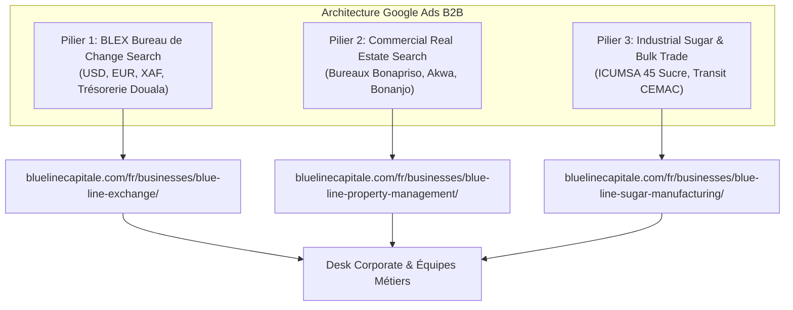

# STRATÉGIE GOOGLE ADS B2B — BLUE LINE CAPITAL GROUP
## Douala & Corridor Régional CEMAC (Cameroun, Tchad, RCA, Gabon, Congo)
**Gestion :** My AI Custom  
**Siège :** Douala, Cameroun  
**Piliers Métiers :** Blue Line Exchange (BLEX), Immobilier d'Entreprise, Sucre Industriel & Négoce  
**Langues :** Bilingue Français & Anglais  
**Budget Recommandé :** 350 000 à 650 000 XAF / mois  

---

## 1. Objectifs & Positionnement
- **Nature :** Groupe holding institutionnel opérant sur des services B2B à haute valeur transactionnelle.
- **Piliers Publicitaires :**
  1. **BLEX (Bureau de Change) :** Opérations de change de devises (USD, EUR, XAF, AED), traçabilité de trésorerie, règlements d'import/export.
  2. **Blue Line Property Management :** Baux commerciaux et location de bureaux haut standing à Bonapriso, Akwa et Bonanjo.
  3. **Blue Line Sugar Manufacturing & Trade :** Approvisionnement en sucre blanc raffiné ICUMSA 45 pour industriels et grossistes au Cameroun et zone CEMAC.
- **Conversion Pivot :** Prise de contact avec les desks spécialisés, demandes de cotation B2B, formulaires d'intérêt institutionnel.

---

## 2. Structure des Campagnes B2B

---

## 3. Mots-Clés B2B & Ciblage

### Pilier 1 : BLEX — Bureau de Change Douala
- **Français :** `[bureau de change douala]`, `"change dollar euro cfa douala"`, `"taux de change euro franc cfa douala"`, `"achat devises cameroun douala"`, `"virement international cameroun entreprise"`
- **Anglais :** `"forex bureau douala"`, `"currency exchange douala cameroon"`, `"exchange usd eur xaf douala"`, `"corporate money exchange cameroon"`
- **Zones :** Douala, Yaoundé, N'Djamena (Tchad), Bangui (RCA).

### Pilier 2 : Real Estate & Gestion Locative
- **Français :** `[location bureau douala]`, `"location bureau bonapriso douala"`, `"immeuble commercial douala a louer"`, `"bureau a louer akwa douala"`, `"gestion locative entreprise cameroun"`
- **Anglais :** `"office space for rent douala"`, `"commercial real estate douala bonapriso"`, `"property management cameroon"`, `"corporate office rental douala"`
- **Zones :** Douala métropole (focus Bonapriso, Akwa, Bonanjo).

### Pilier 3 : Sucre Industriel & Trade CEMAC
- **Français :** `[fournisseur sucre industriel cameroun]`, `"grossiste sucre douala"`, `"vente sucre icumsa 45 cameroun"`, `"approvisionnement sucre agroalimentaire douala"`
- **Anglais :** `"industrial sugar supplier cameroon"`, `"wholesale sugar douala"`, `"bulk icumsa 45 sugar cemac"`, `"agro commodities trading central africa"`
- **Zones :** Port de Douala, Cameroun, corridor Tchad/RCA.

---

## 4. Mots-Clés Négatifs B2B (Filtre Anti-Détail)
- **Sucre de consommation courante :** `1kg`, `kilo`, `paquet`, `morceau`, `supermarche`, `carrefour`, `recette gateau`
- **Marché noir / Petites coupures :** `change noir`, `marche noir`, `faux billet`, `western union`, `worldremit`, `500 f cfa`
- **Résidentiel modeste :** `chambre etudiant`, `studio 20000`, `chambre a louer`, `colocation`, `pas cher`
- **Emploi :** `recrutement`, `offre d'emploi`, `salaire caissier`, `stage academique`, `cherche travail`

---

## 5. Textes d'Annonces Prêts à l'Emploi (Bilingue FR / EN)

### BLEX — Bureau de Change
- **Titres FR (≤ 30 car.) :** `Bureau de Change Douala` | `Blue Line Exchange BLEX` | `Change Devises USD EUR` | `Taux Compétitifs Douala` | `Opérations Sécurisées`
- **Descriptions FR (≤ 90 car.) :**  
  - `Bureau de change à Douala. Traitement rigoureux des opérations de devises USD, EUR et XAF.`
  - `Opérations de change pour entreprises et professionnels. Précision et sécurité à Douala.`
- **Headlines EN (≤ 30 chars) :** `Forex Bureau Douala` | `Blue Line Exchange BLEX` | `USD EUR XAF Currency FX` | `Competitive Forex Rates` | `Corporate Currency Desk`
- **Descriptions EN (≤ 90 chars) :**  
  - `Professional currency exchange in Douala. Secure handling of USD, EUR, and XAF transactions.`
  - `Corporate FX solutions for international trade and business settlements across CEMAC.`

### Real Estate & Immobilier Commercial
- **Titres FR (≤ 30 car.) :** `Location Bureau Douala` | `Bureaux Bonapriso Douala` | `Immobilier Pro à Akwa` | `Blue Line Property Mgt` | `Baux Commerciaux Douala`
- **Descriptions FR (≤ 90 car.) :**  
  - `Bureaux de prestige à louer à Bonapriso et Akwa. Espaces modulables et sécurisés à Douala.`
  - `Gestion locative d'actifs commerciaux à Douala. Valorisez votre patrimoine immobilier pro.`
- **Headlines EN (≤ 30 chars) :** `Office Space Douala` | `Bonapriso Commercial Rent` | `Prime Offices in Akwa` | `Blue Line Property Mgt` | `Douala Business Leases`
- **Descriptions EN (≤ 90 chars) :**  
  - `Premium office spaces for lease in Bonapriso & Akwa. Secure facilities for corporate firms.`
  - `Commercial property management and leasing in Douala. Tailored solutions for enterprises.`

### Sucre Industriel & Négoce CEMAC
- **Titres FR (≤ 30 car.) :** `Sucre Industriel Cameroun` | `Grossiste Sucre Douala` | `Sucre Blanc ICUMSA 45` | `Approvisionnement CEMAC` | `Transit Port de Douala`
- **Descriptions FR (≤ 90 car.) :**  
  - `Fournisseur de sucre raffiné ICUMSA 45 pour industries et grossistes au Cameroun et CEMAC.`
  - `Approvisionnement régulier en sucre blanc de canne. Disponibilité bord à quai à Douala.`
- **Headlines EN (≤ 30 chars) :** `Industrial Sugar Cameroon` | `Bulk ICUMSA 45 Sugar` | `Wholesale Sugar Douala` | `CEMAC Cross-Border Trade` | `Port of Douala Transit`
- **Descriptions EN (≤ 90 chars) :**  
  - `Refined cane sugar ICUMSA 45 for food manufacturers and wholesalers in Cameroon & CEMAC.`
  - `Consistent bulk sugar supply at Port of Douala. Cross-border transit to Chad and CAR.`

---

## 6. Budget & Prévisions KPI B2B

| Métrique | Phase 1 : Test (350 000 XAF/mois) | Phase 2 : Scale (650 000 XAF/mois) |
|---|---|---|
| **Dépense Quotidienne** | ~11 600 XAF / jour (~17,70 €) | ~21 600 XAF / jour (~33,00 €) |
| **CPC Moyen Estimé** | 380 XAF (~0,58 €) | 420 XAF (~0,64 €) |
| **Clics B2B Ciblés** | **~920 clics** | **~1 550 clics** |
| **Taux de Conversion Lead B2B** | 4,5% | 5,2% |
| **Leads Corporatifs Générés** | **41 prospects d'affaires / mois** | **80 prospects d'affaires / mois** |
| **Coût par Lead B2B (CPL)** | **8 530 XAF (~13,00 €)** | **8 125 XAF (~12,40 €)** |
| **Valeur Unitaire des Deals** | - BLEX : 10M à 50M XAF volume change - Bail bureau : 3M à 15M XAF/an - Sucre : 25M à 100M+ XAF/lot | - Contrats-cadres annuels trésorerie - Baux pluriannuels sièges sociaux - Approvisionnements réguliers usines |
| **Multiple de Pipeline** | **> 50x sur la valeur de transaction** | **> 80x sur la valeur de transaction** |
